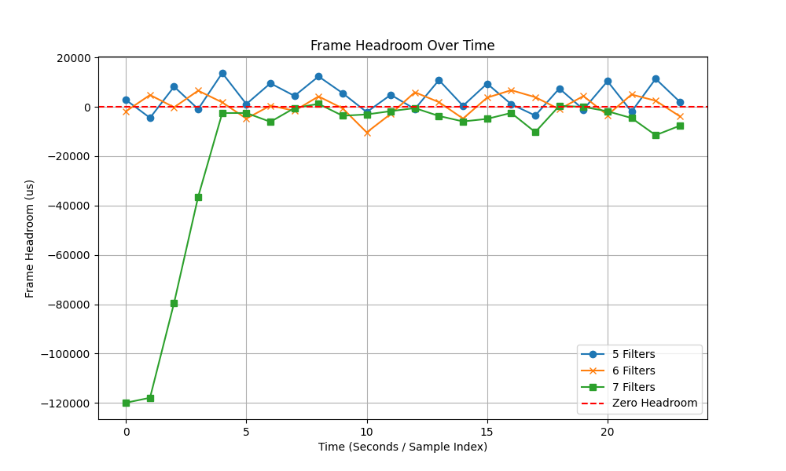

# Single-Threaded Baseline Performance Analysis

## Purpose
We use quantitative methods to measure the headroom trace under increasing FrameProcessor loads. The result will allow us to identify key points where single-threaded scheduling fails to maintain the frame rate.

## Experiment procedure
- This stress test will expand to 3 unique runs with (5, 6, 7) filters. Each will have 24 seconds to test.
- The Vignetter frame processor is used as a controll FrameProcessor, as other processors like `numberer` or `dusterer` are too light-weight.
- **A Python script** will be used to create a visual and investigate where performance begins to drop. These results will later be compared to our modified multi-threaded video player in the future.

## Results
## 5 Vignetter filters
```
# Ran with the command
VideoPlayer -xvvvvv "path\to\SimpsonsTrailer.mp4"
```
<details>
  <summary>Click to view full logs</summary>
  
	Frame headroom is  2769us out of 41708us spare.
	Frame headroom is -4503us out of 41708us spare.
	Frame headroom is  8158us out of 41708us spare.
	Frame headroom is  -936us out of 41708us spare.
	Frame headroom is 13679us out of 41708us spare.
	Frame headroom is  1094us out of 41708us spare.
	Frame headroom is  9518us out of 41708us spare.
	Frame headroom is  4405us out of 41708us spare.
	Frame headroom is 12301us out of 41708us spare.
	Frame headroom is  5518us out of 41708us spare.
	Frame headroom is -2158us out of 41708us spare.
	Frame headroom is  4854us out of 41708us spare.
	Frame headroom is  -918us out of 41708us spare.
	Frame headroom is 10807us out of 41708us spare.
	Frame headroom is   386us out of 41708us spare.
	Frame headroom is  9379us out of 41708us spare.
	Frame headroom is  1066us out of 41708us spare.
	Frame headroom is -3557us out of 41708us spare.
	Frame headroom is  7407us out of 41708us spare.
	Frame headroom is -1113us out of 41708us spare.
	Frame headroom is 10370us out of 41708us spare.
	Frame headroom is -1980us out of 41708us spare.
	Frame headroom is 11337us out of 41708us spare.
	Frame headroom is  2046us out of 41708us spare.
	
	Python data array `[2769, -4503, 8158, -936, 13679, 1094, 9518, 4405, 12301, 5518, -2158, 4854, -918, 10807, 386, 9379, 1066, -3557, 7407, -1113, 10370, -1980, 11337, 2046]`
</details>


### 6 Vignetter Filters
```
# Ran with the command
VideoPlayer -xvvvvvv "path\to\SimpsonsTrailer.mp4"
```

<details>
  <summary>Click to view full logs</summary>
  
	Frame headroom is -1819us out of 41708us spare.
	Frame headroom is  4775us out of 41708us spare.
	Frame headroom is  -210us out of 41708us spare.
	Frame headroom is  6527us out of 41708us spare.
	Frame headroom is  1785us out of 41708us spare.
	Frame headroom is -4793us out of 41708us spare.
	Frame headroom is   471us out of 41708us spare.
	Frame headroom is -1615us out of 41708us spare.
	Frame headroom is  4194us out of 41708us spare.
	Frame headroom is  -650us out of 41708us spare.
	Frame headroom is -10377us out of 41708us spare.
	Frame headroom is -2878us out of 41708us spare.
	Frame headroom is  5883us out of 41708us spare.
	Frame headroom is  1875us out of 41708us spare.
	Frame headroom is -4789us out of 41708us spare.
	Frame headroom is  3693us out of 41708us spare.
	Frame headroom is  6723us out of 41708us spare.
	Frame headroom is  3894us out of 41708us spare.
	Frame headroom is -1000us out of 41708us spare.
	Frame headroom is  4342us out of 41708us spare.
	Frame headroom is -3357us out of 41708us spare.
	Frame headroom is  4961us out of 41708us spare.
	Frame headroom is  2450us out of 41708us spare.
	Frame headroom is -3835us out of 41708us spare.
	
	Python data array `[-1819, 4775, -210, 6527, 1785, -4793, 471, -1615, 4194, -650, -10377, -2878, 5883, 1875, -4789, 3693, 6723, 3894, -1000, 4342, -3357, 4961, 2450, -3835]`
	
</details>

### 7 Vignetter filters
```
# Ran with the command
VideoPlayer -xvvvvvvv "path\to\SimpsonsTrailer.mp4"
```

<details>
  <summary>Click to view full logs</summary>
  
	Frame headroom is -119906us out of 41708us spare.
	Frame headroom is -117913us out of 41708us spare.
	Frame headroom is -79448us out of 41708us spare.
	Frame headroom is -36460us out of 41708us spare.
	Frame headroom is -2552us out of 41708us spare.
	Frame headroom is -2516us out of 41708us spare.
	Frame headroom is -6099us out of 41708us spare.
	Frame headroom is  -509us out of 41708us spare.
	Frame headroom is  1187us out of 41708us spare.
	Frame headroom is -3646us out of 41708us spare.
	Frame headroom is -3105us out of 41708us spare.
	Frame headroom is -1769us out of 41708us spare.
	Frame headroom is  -540us out of 41708us spare.
	Frame headroom is -3735us out of 41708us spare.
	Frame headroom is -5950us out of 41708us spare.
	Frame headroom is -4905us out of 41708us spare.
	Frame headroom is -2501us out of 41708us spare.
	Frame headroom is -10272us out of 41708us spare.
	Frame headroom is   373us out of 41708us spare.
	Frame headroom is   -51us out of 41708us spare.
	Frame headroom is -1820us out of 41708us spare.
	Frame headroom is -4572us out of 41708us spare.
	Frame headroom is -11513us out of 41708us spare.
	Frame headroom is -7688us out of 41708us spare.
	
	Python data array `[-119906, -117913, -79448, -36460, -2552, -2516, -6099, -509, 1187, -3646, -3105, -1769, -540, -3735, -5950, -4905, -2501, -10272, 373, -51, -1820, -4572, -11513, -7688]`
	
</details>


## Findings

As shown below, of course the more filters the less consistent the frames are. 
| Filters | Mean headroom | Missed deadlines (us < 0) |
| --- | --- | --- |
| 5 Filters | +4164us | 7/29 (29%) |
| 6 Filters | +677us | 11/24 (46%) |
| 7 Filters | -17746us | 22/24 (92%) |



This reveals that:
- 5 Filters is marginally stable, having a nice positive mean and only missed a few deadlines. 
- 6 Filters oscillates aroun d the zero headroom, and the single CPU core is ~99% utilised.
- 7 Filters shows the massive cold-start spike, and stabalises after ~4 seconds, but still mostly not meeting the deadline.